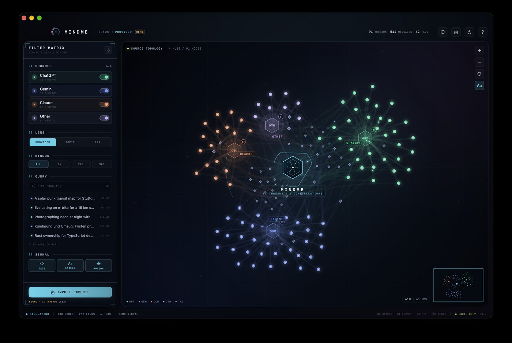
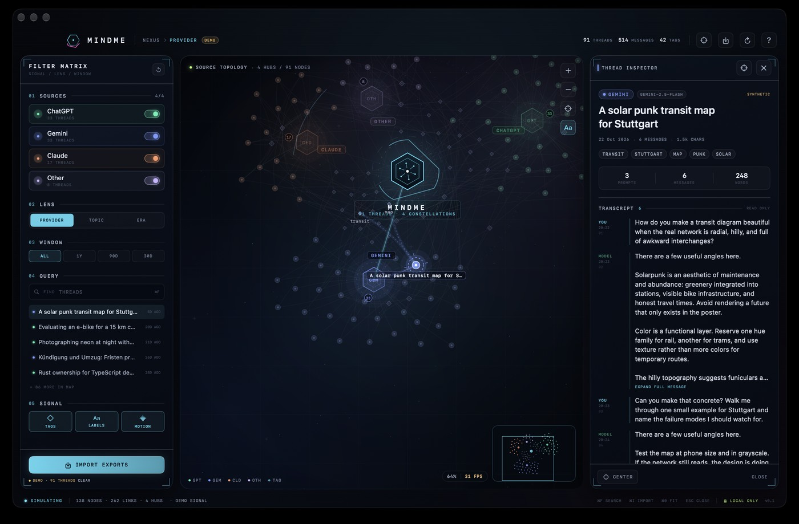
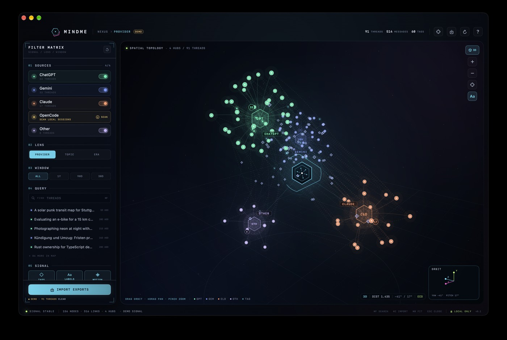

# MINDME

A futuristic, local-first mind map for the conversations you have with different AI assistants. Import exports from **ChatGPT**, **Google Gemini**, and **Claude**, scan your local **OpenCode** session library, or bring your own JSON — then explore everything as a living constellation of sources, topics, and shared language.





The same constellation in spatial mode:



## What it does

- **Loads real conversations** — ChatGPT `conversations.json`, Google Takeout Gemini Apps activity, Claude `conversations.json`, HTML Takeout pages (best effort), the local OpenCode SQLite library, and a documented generic schema.
- **Groups the map** by provider, shared topic keyword, time period, or hierarchical **region**.
- **Classifies conversations and their parts** — each thread is segmented where the topic actually changes, then scored against an editable region spine (product, technology, legal, finance, design, research, operations, personal) with sub-regions underneath. A mixed project thread can be 60% technology and 40% legal; the inspector shows every segment.
- **Shows where the money went** — an opt-in **COST** overlay heats regions and sub-regions by provider-reported spend, draws a gauge for each hub's share of the most expensive topic, and puts dollar totals on the map. Built for OpenCode archives; other providers simply have no cost data.
- **Searches live** — typing highlights matching conversations and their paths in place while the map, cloud, and hybrid lenses stay intact; press **Return** (or **ISOLATE**) to filter the map down to the hits and **SHOW ALL** to bring the full constellation back. Source and time-window filters still rebuild instantly, with a live thread index.
- **Connects conversations** through shared keyword tags, creating bridges across providers without merging the underlying threads.
- **Inspects everything** — select a node to read the transcript, see metadata, jump to the source in the browser, or click a tag to isolate every conversation behind it.
- **Feels alive** — an animated force-directed constellation with neon HUD panels, energy pulses along active paths, a minimap, and an animated camera.
- **2D or 3D** — flip the map into a spatial perspective with a z-axis, depth-sorted nodes, a perspective floor, and an orbit camera. Drag to orbit, Shift-drag to pan, pinch or use +/− to zoom.
- **Word cloud** — switch the same filtered library into a semantic cloud where keywords are sized by how many conversations share them. Click a word to isolate its threads. Toggle with **⌘4**, the **CLOUD** view control, or the sidebar.
- **Hybrid cloud** — keep the constellation's root, hubs, threads, and links while sizing and anchoring the words to their tag nodes. The map structure stays visible beneath the vocabulary. Toggle with **⌘5**, the **HYBRID** control, or the sidebar.
- **Stays on your device** — no accounts, no telemetry. The Mac and iPhone apps make no network calls and normalize data into their local Application Support container. The Quest viewer reads the exported library on-device and stores it in the headset browser's local storage.

A curated **demo dataset** is generated on first launch so the map is explorable before importing anything. Demo threads are labelled and can be cleared with one click; the first real import clears them automatically.

## Requirements

- macOS 14 or newer for the desktop app
- iOS 17 or newer on an iPhone for the mobile app
- Xcode 16+ (built and tested with Xcode 27 / Swift 6.4)
- [XcodeGen](https://github.com/yonaskolb/XcodeGen) (`brew install xcodegen`) to regenerate the Xcode project
- Node.js 22+ and a **Meta Quest 3** — or desktop Chromium for the XR simulator — for the WebXR viewer in [`spatial/`](spatial)

## Run it

```bash
cd MindMap
make run          # generate project, build Debug, open the Mac app
```

Or open `MindMap/MindMap.xcodeproj` in Xcode and run the `MindMap` scheme.

Build a distributable app bundle:

```bash
make release      # -> MindMap/dist/MINDME.app
make install      # -> ~/Applications/MINDME.app
```

Run the test suites (importers, keyword extraction, clustering, graph filters, layout, storage, cameras, word clouds):

```bash
make test          # core suite
make test-app      # app logic suite (cameras, graph engine, cloud layouts)
make test-all      # both
```

## Meta Quest 3

The headset build is a WebXR app in [`spatial/`](spatial). It opens in the Meta Quest Browser,
reads a normalized library export, and renders the constellation in room-scale space with a
world-space control board and inspector. Import and analysis happen in the Mac or iPhone app;
the headset build is the viewer for the normalized library.

```bash
cd MindMap
make run                       # 1. import exports and analyze them (Mac)
# File → Export Library for Quest… (⌘E)   → mindme-library.json
# On iPhone: ••• → Export Library for Quest… → save to Files

cd ../spatial
npm install
npm run dev                    # 2. http://localhost:5173 (flat preview)
adb reverse tcp:5173 tcp:5173  # 3. headset → http://localhost:5173
```

Open `http://localhost:5173` in the Quest Browser, press **LOAD JSON**, then **ENTER VR**. The
hosted build lives at <https://403access.github.io/mindme/quest/> and is published from the docs
workflow. Controls, deployment options, and the module map are in [`spatial/README.md`](spatial/README.md).

The headset build supports provider/topic/era groupings, provider and time filters, tags, the
spend overlay, focus paths, and transcript inspection. Region grouping, the word-cloud lenses,
raw export import, and topic reclassification stay in the Mac and iPhone apps.

No headset handy? `cd spatial && npm run dev:sim` runs the actual immersive session in desktop
Chromium (or a VM) through Meta's IWER simulator, including simulated Quest controllers and a
DevUI overlay. It is development-only and never overrides native WebXR on a headset.

## Documentation site

The docs are a [Docusaurus](https://docusaurus.io) site in [`website/`](website). Run it locally:

```bash
cd website
npm install
npm start         # http://localhost:3000/mindme/
```

`npm run build` produces a static site in `website/build`. Pushing changes under `website/` or
`spatial/` to `main` deploys it to GitHub Pages via
[`.github/workflows/docs.yml`](.github/workflows/docs.yml); the Quest build is published at
`/mindme/quest/`. Enable **Settings → Pages → Source: GitHub Actions** once in the repository
settings.

## Importing conversations

| Source | Where to get it | File to import |
| --- | --- | --- |
| ChatGPT | Settings → Data controls → Export data | `conversations.json` |
| Gemini | Google Takeout → My Activity → Gemini Apps | `My Activity.json` (or the Takeout folder) |
| Claude | Settings → Privacy → Export data | `conversations.json` |
| OpenCode | Already on this Mac (or pick the `.db` on iPhone) | File → Import OpenCode Sessions (⌘⇧O), or drop `opencode.db` |
| Any tool | MINDME generic schema | a `.json` file with a `threads` array |

You can drag files or whole folders onto the window, or press **⌘I**. The importer groups Gemini activity prompts by their conversation URL (falling back to a per-day bucket), reconstructs ChatGPT's active branch from `current_node` → parents, and skips hidden/system nodes.

Small synthetic exports for every format live in [`MindMap/Samples`](MindMap/Samples) — drag one onto the app to try the importer without sharing your own data.

### OpenCode

OpenCode stores its history in `~/.local/share/opencode/opencode.db`. MINDME opens that database **read-only in place** (nothing is copied) and normalizes the **150 most recently active top-level sessions**, including human prompts and assistant text. Subagent sessions, reasoning traces, tool calls, patches, and snapshots are intentionally excluded. The import takes under a second for a typical library; import again with ⌘⇧O to merge newer sessions.

The importer reads the `session_v2` / `session_message` schema used by current OpenCode releases. The session limit is `OpenCodeImporter.defaultSessionLimit`, and per-thread message caps live alongside it in `Core/Sources/MindMapCore/Import/OpenCodeImporter.swift`.

The synthetic demo archive remains available at any time via **File → Load Demo Dataset**; importing real data clears it so the map shows only your conversations.

### Generic schema

```json
{
  "threads": [
    {
      "id": "conversation-123",
      "provider": "gemini",
      "title": "Designing a solar punk transit map",
      "createdAt": "2026-03-01T10:00:00Z",
      "model": "gemini-3-pro",
      "messages": [
        { "role": "user", "text": "How do I start?", "timestamp": "2026-03-01T10:00:00Z" },
        { "role": "assistant", "text": "Start from topology…" }
      ]
    }
  ]
}
```

`provider` accepts `chatgpt`, `gemini`, `claude`, `opencode`, or anything else (shown as *Other*). If `provider` is omitted, MINDME infers it from the filename when possible.

## Regions and sub-regions

Choose **REGION** in the Lens section (or *Map → Group By → Region*). The map becomes two levels deep:

- an inner hub per **region** — Product, Technology, Legal, Finance, Design, Research, Operations, Personal, Emerging
- a ring of **sub-region** hubs inside it — e.g. Technology splits into Software, Architecture, and AI
- conversations fan out from the sub-region they spend most of their words in

The pipeline runs entirely on-device:

1. **Segment** each thread into exchanges (prompt + reply) and cut where the vocabulary shifts, time gap grows, or the prompt contains an explicit cue ("now let's switch to the contract").
2. **Classify** each segment against the taxonomy, parents gating children, using deterministic hashed text embeddings plus a seed lexicon (English + German).
3. **Smooth** the sequence with Viterbi so a single stray paragraph cannot tear a region apart.
4. **Roll up** weighted by prompt length — assistant verbosity does not get to pick the topic. The result is a soft distribution: a thread can belong to several regions.
5. **Cache** profiles per thread content hash in `~/Library/Application Support/MindMap/topics.json`; importing new chats does not reclassify old ones.

The default taxonomy lives in `Core/Sources/MindMapCore/Analysis/Topics/TopicTaxonomy.swift` and is mirrored to `~/Library/Application Support/MindMap/taxonomy.json` on first run. Edit labels, descriptions, or seeds there and use *Map → Reclassify Topics* (⌘⇧T) — no rebuild required. Low-confidence material lands in **Emerging** instead of being forced into a wrong region.

### Spend heat

OpenCode stores a dollar cost and token counts per session and per assistant message. Turn on **COST** in the Signal panel, the map's top-right controls, or *Map → Show Spend Heat* (off by default):

- Hubs ramp from mint (cheap) through amber to coral (most expensive) and draw a circular gauge for their share of the priciest region.
- Cost badges replace thread counts so the map stays about money while the overlay is on.
- The telemetry strip shows total visible spend and the top region.
- Open a thread or region to see total spend, tokens, cost per message, and per-segment costs.
- A conversation is placed in the sub-region where most of its spend occurred, not merely where most of its text went.

Spend never leaves the Mac and is read directly from the OpenCode database. ChatGPT, Gemini, and Claude exports do not include cost data, so the overlay simply has nothing to show for them.

## Reading the map

- **Root hexagon** — all currently visible threads.
- **Provider hub** — one per source; the count badge shows how many conversations it contains.
- **Conversation node** — size scales with message volume; colour follows the provider.
- **Diamond tag** — a keyword shared by at least two conversations. It links threads across providers.
- **Bright path** — the selected thread, its cluster, and its tags; everything else dims to keep context.

Interaction:

| Action | Result |
| --- | --- |
| Drag / pinch (2D) | Pan / zoom (trackpad magnify or the +/- controls) |
| **⌘3** or the **2D/3D** map control | Toggle the spatial perspective |
| **⌘4** or the **CLOUD** control | Switch to the free word cloud |
| **⌘5** or the **HYBRID** control | Show the word cloud inside the constellation structure |
| Drag (3D) | Orbit the camera around the root |
| **Shift**-drag (3D) | Pan the camera target across the scene |
| Pinch / +− (3D) | Move the camera closer or farther |
| Click a node | Highlight its path and open the inspector |
| Click a thread in the sidebar | Jump to its constellation and open the transcript |
| Click a tag chip in the inspector | Isolate every thread behind that tag |
| Click a word in the cloud | Isolate its threads and open the tag inspector |
| **⌘0** | Fit the whole map |
| **⌘F** | Focus the search field |
| Type in search | Highlight matches and their paths in place |
| **Return** in search | Isolate the map to the hits (toggle back with **SHOW ALL**) |
| **⌘I** | Import exports |
| **⌘3** | Toggle 3D perspective |
| **⌘4** | Toggle the free word cloud |
| **⌘5** | Toggle the hybrid cloud |
| **⌘R** | Reload the local library |
| **Esc** | Deselect / close the inspector |

## Architecture

> **Deep dive:** [website/docs/visualization.md](website/docs/visualization.md) documents the graph model, keyword pipeline, both layouts, cameras, renderer, and extension points. The default visualization is a node-link constellation — keywords become diamond tag nodes and topic hubs, not sized text. Two opt-in cloud lenses sit over the same filtered tag data: a free word cloud (⌘4) and a hybrid cloud (⌘5) anchored to the constellation.

```
MindMap/
├── App/                     SwiftUI app (macOS + iPhone)
│   ├── MindMapApp.swift     app lifecycle, menus (macOS) / mobile entry (iOS)
│   ├── AppModel.swift       library, filters, import orchestration
│   ├── MobileRootView.swift iPhone shell: top bar, sheets, document pickers
│   ├── Platform.swift       AppKit/UIKit shims, export document, cursor + active state
│   ├── GraphEngine.swift    simulation clock, 2D/3D cameras, hit testing, render throttling
│   ├── Perspective.swift    perspective camera, projection, 3D fit
│   ├── MapRenderer.swift    Canvas renderer (2D/3D nodes, edges, labels, depth)
│   ├── WordCloudView.swift  free word-cloud layout, renderer, hover cards, empty state
│   ├── HybridWords.swift    constellation-anchored word layout and renderer
│   ├── GraphCanvasView.swift gestures, minimap, orbit gizmo, hover cards, empty state
│   ├── SidebarView.swift    filter matrix
│   ├── DetailPanelView.swift thread/cluster inspector
│   └── Theme.swift          HUD design system
└── Core/                    Swift package, UI-independent and testable
    ├── Models/              ConversationThread, ChatMessage, Provider, ThreadLibrary
    ├── Import/              format sniffing + ChatGPT/Gemini/Claude/OpenCode/generic parsers
    ├── Analysis/            keyword extraction + topic clustering
    │   └── Topics/           segmentation, taxonomy, classifier, smoothing
    ├── Graph/               graph builder, 2D anchors/force layout, 3D anchors
    ├── Store/               local JSON persistence
    └── Demo/                deterministic demo archive

spatial/                     WebXR viewer for Meta Quest 3 (three.js + Vite)
├── src/data/                library normalization, keywords, graph, 3D anchors
├── src/render/              instanced constellation, canvas labels
├── src/ui/                  world-space panels + flat DOM HUD
├── src/xr.js                session, controller/hand rays, locomotion
└── scripts/check.mjs        headless data checks
```

**Performance notes:** the 2D force simulation runs at 60 Hz only while settling (about six seconds), then the renderer drops to a 10 fps ambient clock. The 3D layout is deterministic and static; orbiting and projecting it is cheap, and the same throttle applies. The free word cloud packs words once per filter/size change and only animates a gentle 15 fps drift while it is on screen. The hybrid cloud caches keyword seeds, colours, and measured text per graph and re-places words only when the projection changes; word collisions use a spatial grid, and a settled camera costs a single cache-key comparison per frame. Projections are shared across the map's edge/node/label passes, and focus paths are resolved once per frame instead of per edge. All node sizes and labels are drawn in screen space so zoom changes spacing but never legibility, and the canvas only publishes a frame when something actually changed. Toggle **MOTION** off in the sidebar (or *Map → Ambient Motion*) for an essentially static, near-zero-idle-CPU map.

**Privacy:** neither the macOS nor the iPhone app has networking code. Export files and the OpenCode database are parsed locally and normalized into a JSON library in Application Support. Use *File → Reveal Library in Finder* to inspect or delete it. The Quest viewer loads a static bundle but parses and stores the library on the headset; it has no accounts, analytics, or telemetry.

## Limitations / notes

- Google Takeout's Gemini activity export contains prompts but generally **not** model responses; those conversations appear as prompt-only threads.
- OpenCode imports the 150 most recent top-level sessions. Very large coding sessions are trimmed to the first 10 + last 50 messages, and individual messages are capped at 5,000 characters so the library stays responsive.
- Gemini HTML exports are parsed best-effort; the JSON activity export is more reliable.
- ChatGPT branches: MINDME follows the currently selected branch (`current_node`), not abandoned regenerations.
- The map renders at most 420 conversations at once (configurable in `GraphFilters.maxThreads`); use source/time/search filters for very large archives.
- Keyword extraction is intentionally lightweight (TF-IDF-ish, English + German stopwords). Topic classification uses deterministic hashed bag-of-words embeddings plus seed vocabularies — explainable and offline, not a neural sentence encoder. The `TopicEmbeddingProvider` protocol is the seam for dropping in a bundled CoreML MiniLM later.
- Topic analysis runs once per archive change and caches every thread profile by content hash. A 400-thread library takes a couple of seconds on first run; later launches reuse `topics.json`, and only new or edited conversations are reclassified.
- The Mac app is ad-hoc signed for local use. For distribution you will want your own Developer ID and notarization. The iOS target uses automatic signing and needs a development team selected for on-device builds; simulator builds need no signing.
- The Quest viewer accepts the normalized MINDME library JSON, not raw provider exports. Import in the Mac or iPhone app, then use **File → Export Library for Quest…** (macOS) or **••• → Export Library for Quest…** (iPhone). It needs a secure context: `localhost` over `adb reverse`, or HTTPS hosting.

## iPhone

MINDME has a native iPhone target built from the same SwiftUI rendering layer and `MindMapCore`
pipeline as the Mac app. It is designed for a phone screen first:

- The constellation fills the screen; the filter matrix opens as a sheet from the top bar.
- Tapping a node opens the inspector as a sheet. Drag to pan, pinch to zoom, and use the on-map
  2D/3D and lens controls.
- **Import** uses the Files picker (JSON, HTML, SQLite, or a whole Takeout folder). Files are read
  with security-scoped access and normalized into the app container.
- **Export Library for Quest** writes the same JSON through the system share sheet.
- OpenCode's `~/.local/share/opencode/opencode.db` scan is Mac-only because iOS is sandboxed; you
  can still pick an `opencode.db` file manually with Import.

Build it for the iPhone Simulator:

```bash
cd MindMap
make ios          # generate project, build for iOS Simulator
```

Or open `MindMap/MindMap.xcodeproj`, choose the `MindMapIOS` scheme, and run on an iPhone
simulator or device. The iOS target is iPhone-only for now (`TARGETED_DEVICE_FAMILY = 1`).

To install directly on a connected iPhone:

```bash
make ios-device DEVICE_ID=00008101-... TEAM_ID=ABCDE12345
```

Find `DEVICE_ID` with `xcrun devicectl list devices` and `TEAM_ID` in Xcode → Settings →
Accounts → your team. The target uses automatic signing and `-allowProvisioningUpdates`, so a
development profile is created on the first device build.

The mobile presentation lives in `App/MobileRootView.swift`; `App/Platform.swift` isolates the
handful of AppKit/UIKit differences (text measurement, pointer cursors, active state, file
location). `MindMapCore` itself is unchanged apart from platform-safe home-directory fallbacks.

For VR, the WebXR build in [`spatial/`](spatial) reimplements the graph, keyword extraction, 3D anchors, and palette in JavaScript so the same library looks and behaves the same in the headset. See [the Quest guide](https://403access.github.io/mindme/docs/quest).
